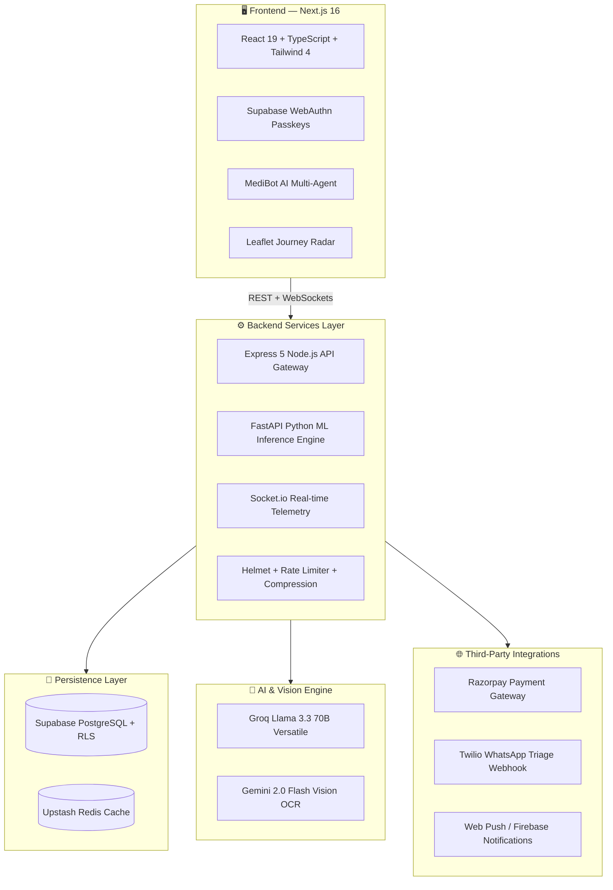

<div align="center">

# 🏥 Arogya Raksha

### AI-Powered Decentralized Healthcare & Hospital Operating System

**आरोग्य रक्षा** — *Your Health, Our Priority*

[](https://ai.google.dev/)
[](./LICENSE)
[](https://nextjs.org)
[](https://expressjs.com)
[](https://supabase.com)
[](https://typescriptlang.org)

<br />

**A production-grade, AI-native healthcare platform uniting Patients, ASHA Field Workers, Doctors, Hospital Admins, Pharmacists, and Ambulance Teams with 23 official Indian languages and WebAuthn biometric security.**

[🚀 Live Demo](https://arogya-raksha.vercel.app) · [📖 Master Documentation](./project_documentation.md) · [🐛 Report Bug](https://github.com/ifthekharahmad69-ship-it/arogyaa-rakshaa/issues)

</div>

---

## ✨ Platform Highlights

> **Enterprise-Ready Healthcare Operating System** — Built with real-time WebSocket communication, dual Node.js/Python backend, biometric passkeys, inpatient bed management, forensic OCR scanning, and 9 machine learning clinical predictors.

| Metric | Count |
|---|---|
| 💊 Medicines in Database | **250,000+** |
| 🏥 Geocoded Health Facilities | **200,000+** |
| 🌍 Official Indian Languages | **23** (All 22 Eighth Schedule languages + English) |
| 🤖 AI & ML Predictors | **10+** Models |
| 👥 Dedicated Role Interfaces | **6** (Patient, ASHA, Doctor, Hospital Admin, Pharmacy, Ambulance) |
| 🔗 Backend REST Routes | **20+** Endpoints |
| 📄 Frontend App Routes | **18** Workspaces |

---

## 🎯 Core Present Features

<table>
<tr>
<td width="50%">

### 🤖 MediBot AI Clinical Agent
Multi-turn conversational assistant with clinical tool-calling, Whisper voice input (STT), and audio voice output (TTS).

### 🩺 AI Doctor & Symptom Checker
Dynamic triage engine computing urgency levels (`mild`, `moderate`, `severe`, `emergency`), differential diagnosis, and OTC guidance.

### 🔍 Forensic Medicine Scanner OCR
Canvas de-blurring preprocessor + Gemini 2.0 Flash Vision extracting salt formulations, dosage, warnings, and expiry from medicine packs.

### 💊 250,000+ Medicine Intelligence
Comprehensive Indian pharmaceutical directory with price comparisons, dosage indications, and generic chemical alternatives.

### 📊 9 Clinical ML Health Predictors
Trained statistical/ML inference for Diabetes, Heart Disease, Dengue Fever, Kidney (CKD), Liver, Lung, Cancer, Asthma, and Mental Health.

</td>
<td width="50%">

### 🏥 Hospital Inpatient & Bed Management
Live ward bed tracker (General, ICU, Emergency, Paediatric, Maternity) with an 8-stage clinical patient admission lifecycle.

### 🧭 Live Journey Radar & Ambulance GPS
Real-time Leaflet GPS tracking streaming ambulance telemetry, speed, route polyline, and live arrival ETA.

### 🎫 Smart Appointments & Care Flow
Dynamic token-based OPD queue management, live wait-time forecasting, doctor EHR consultation, and Razorpay payments.

### 🆔 Digital Medical Profile & Emergency ID
Verifiable patient profile with scannable Emergency QR code, blood group, allergies, and local-first Supabase cloud sync.

### 🔐 WebAuthn Biometric Passkeys
Zero-password sign-in using device biometrics (Touch ID, Face ID, Windows Hello) and Google OAuth via Supabase.

</td>
</tr>
</table>

---

## 🏗 System Architecture



---

## 🛠 Tech Stack

| Layer | Technologies |
|---|---|
| **Frontend** | Next.js 16 (App Router), React 19, TypeScript 5, Tailwind CSS 4, Lucide Icons |
| **Backend** | Express 5, Node.js, Socket.io, FastAPI (Python), Uvicorn |
| **Database** | Supabase (PostgreSQL with RLS), Upstash Redis |
| **AI/ML** | Groq Llama 3.3 70B, Google Gemini 2.0 Flash Vision, Scikit-Learn, Pandas, NumPy |
| **Authentication** | Supabase WebAuthn Biometric Passkeys, Google OAuth, Magic Links |
| **Payments** | Razorpay Checkout SDK |
| **Maps & GPS** | Leaflet, React-Leaflet, OpenStreetMap |
| **Messaging** | Twilio WhatsApp Webhook API |
| **Deployment** | Vercel (Frontend) + Render (Node.js API & Docker) |

---

## 👥 6 Dedicated Role Workspaces

1. **🧑‍⚕️ Patient Console:** Symptom checker, MediBot assistant, medicine catalog, appointment flow, reports analyzer, and emergency SOS.
2. **👩‍🌾 ASHA Field Desk:** Community roster, village OPD queue ticket generator, immunization tracking, and emergency referrals.
3. **👨‍⚕️ Doctor EHR Platform:** Live waiting room queue, patient history, digital prescription drafting, and lab requisitions.
4. **🏥 Hospital Admin Operations:** Inpatient bed occupancy, ward management, doctor duty roster, and pharmacy stock monitor.
5. **💊 Pharmacy Console:** Digital prescription dispensing queue, drug inventory, and medicine delivery radar.
6. **🚑 Ambulance Dispatch:** Active emergency calls, turn-by-turn GPS routing, driver telemetry, and trauma hospital handoff.

---

## 🚀 Quick Start

### Prerequisites
- Node.js 18+
- npm or yarn
- Python 3.10+ (for ML backend)
- [Supabase](https://supabase.com) project

### 1. Backend Setup
```bash
cd backend
cp .env.example .env          # Add your credentials
npm install
npm run dev                   # Starts Express 5 API on http://localhost:5000
```

### 2. Frontend Setup
```bash
cd frontend
cp .env.example .env.local    # Add your credentials
npm install
npm run dev                   # Starts Next.js 16 app on http://localhost:3000
```

---

## 🌍 Multilingual Support (23 Official Languages)

Supported across English and all 22 Eighth Schedule languages of the Indian Constitution:

`en` (English) · `hi` (हिंदी) · `te` (తెలుగు) · `ta` (தமிழ்) · `kn` (ಕನ್ನಡ) · `mr` (मराठी) · `bn` (বাংলা) · `gu` (ગુજરાતી) · `pa` (ਪੰਜਾਬੀ) · `or` (ଓଡ଼ିଆ) · `as` (অসমীয়া) · `ur` (اردو) · `ml` (മലയാളം) · `bho` (भोजपुरी) · `mai` (मैथिली) · `sat` (ᱥᱟᱱᱛᱟᱲᱤ) · `kok` (कोंकणी) · `doi` (डोगरी) · `ks` (کٲشُر) · `mni` (মেইতেই) · `ne` (नेपाली) · `sd` (سنڌي) · `sa` (संस्कृतम्)

---

## 👥 Team SSRRK

Built with ❤️ for the **Google Gemini Hackathon 2026**
